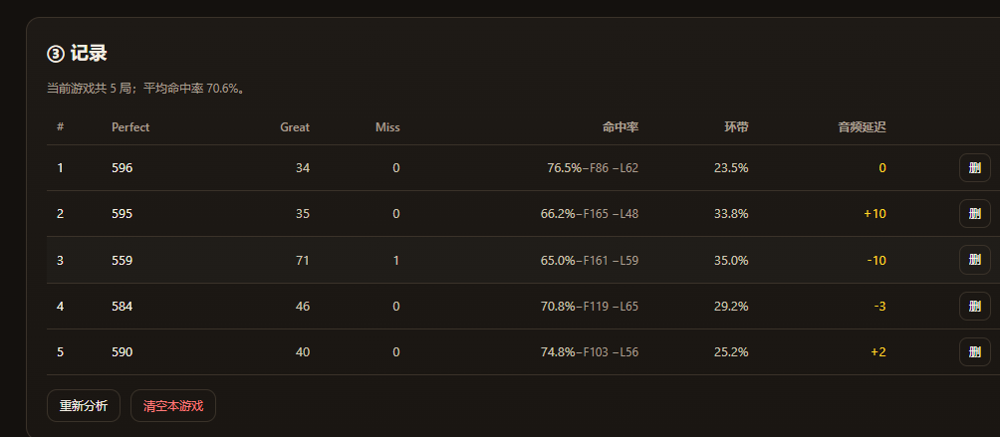
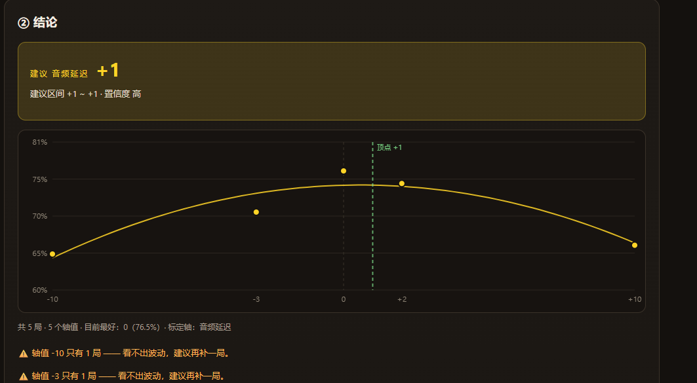

## 测试 Test Cases

### 1. Muse Dash (电脑端/PC)

#### 分别以不同延迟游玩了高手难度的《Baqeela》

#### Used different delay to play the second difficulty of "Baqeela"

结果如下 Results:

0 偏移 0 Delay:

+0.01 偏移 +0.01 Delay:

-0.01 偏移 -0.01 Delay:

-0.003 偏移 -0.003 Delay:

+0.002 偏移 +0.002 Delay:

根据上面的数据写出的表格:
Created a form that uses the data above:

根据上面的数据，我们拟合出了一条曲线，并且预测其最高峰在于设置延迟为0.001.

之后按照延迟0.001进行游戏，结果如下:

可以发现PERFECT数是在这六组游戏数据里面最高(609)
