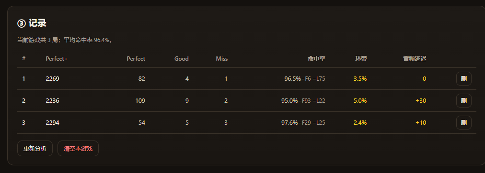
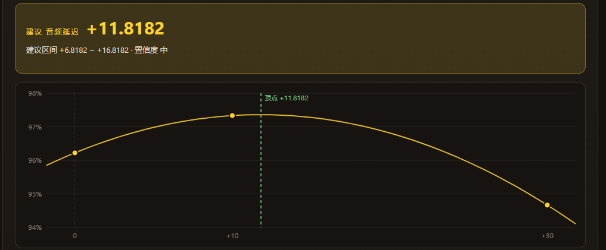
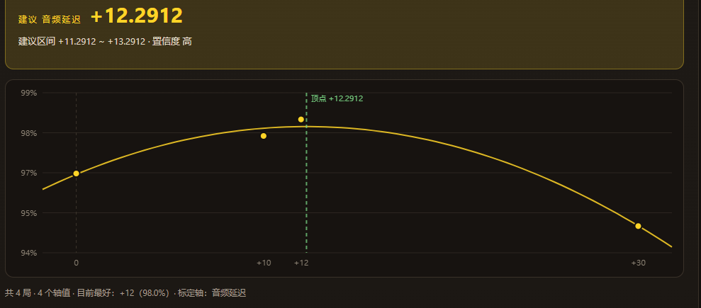

## 测试 Test Cases

### 2. Rotaeno (手机端/Phone)

#### 分别以不同延迟游玩了高手难度的《ΒinαrΨ // Re:Coded》

#### Used different delay to play the second difficulty of "ΒinαrΨ // Re:Coded"

结果如下 Results:

0 偏移 0 Delay:

+30 偏移 +0.01 Delay:

+10 偏移 -0.01 Delay:

根据上面的数据写出的表格:
Created a form that uses the data above:

根据上面的数据，我们拟合出了一条曲线，并且预测其最高峰在于设置延迟约为11.8.

之后按照延迟12进行游戏，结果如下:

得到了最高分和最多Perfect+/Perfect

最后把最后一局的数据录入，最高峰依旧是12左右，说明预测的最佳延迟是12

